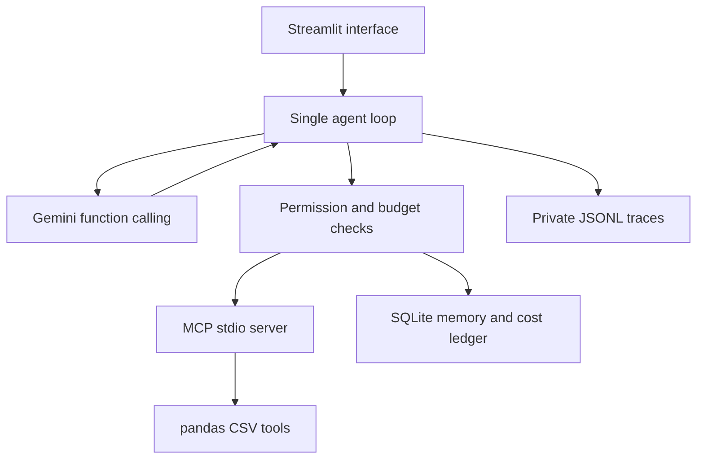

# Architecture and evidence

The model chooses tools. The host validates arguments, authorizes the selected dataset, gates writes, counts/reserves tokens and records actions. The MCP server performs the actual bounded calculations. Structured tool results become evidence IDs in subsequent model context. `final_answer` is a host control, not an MCP function. Conversation contents preserve Gemini's opaque thought signatures when present; traces record actions/results and usage, not private chain of thought.

## Persistence and isolation

SQLite resides under `DATALENS_DATA_DIR`. Each browser session has a cryptographically random 256-bit workspace recovery key; only its SHA-256 hash is used on disk. The UI shows the key only in a recovery expander and accepts it via a password field. Restoring it retrieves task history after restarting. It is a bearer credential, not full user authentication. Keep it private. A new browser session starts a new workspace unless restored. Active approval/conversation state lives in the current Streamlit session; restart loses a pending task, while completed summaries and cost reservations persist.

Railway must mount a persistent volume at `/data`. A volume-less container does not satisfy durable restart/deploy persistence. Run a single application replica; local SQLite is not intended as a shared multi-node database.

## Limits and threat model

* 5 MB, 50,000 rows and 80 columns per UTF-8 CSV. One file per task. No Excel/OCR/PDF.
* Returns bounded samples and at most 30 rows/groups per tool. Truncation is explicit.
* Numeric aggregations exclude nulls; absent cost data cannot support profit calculations.
* No arbitrary Python, shell, SQL, URLs or filesystem paths in model tools.
* Unknown tool names and schema fields are rejected, including model-supplied approval tokens.
* Report grants bind exact content and scope, expire after ten minutes and are single-use.
* Dataset text and stored summaries remain untrusted. Prompt instructions help, but the host/server enforce resource permissions even if the model follows malicious text.
* Tool/server errors are preserved as evidence. Provider exception bodies are not logged, to avoid leaking credentials.
* UI renders model answers/reports as plain text, preventing model-generated remote image requests or HTML. Downloaded Markdown remains untrusted text.
* CSV samples/results and memory snippets are sent to Gemini; disclose this before analysis. Uploaded private CSVs and runtime traces are never committed.
* Public deployment is a capstone demo, not a hardened multi-tenant service. Set an access code before sharing an owner-funded API key widely. The daily budget is global and can be exhausted by visitors. No automatic retention/purge policy is implemented; the owner manages stored files.

## Verification layers

1. Unit/integration tests use a scripted model **and a real MCP subprocess**, testing exact calculations, loop behavior, permissions and failure handling.
2. Restart test writes SQLite and reads it from an independent Python process.
3. Streamlit AppTest verifies the interface and missing-key flow.
4. GitHub Actions builds a Docker image and checks `/_stcore/health`. This only verifies application startup, not Gemini connectivity.
5. `scripts/live_eval.py` requires real credentials and records ten live cases. It fails rather than substituting mock output. Review final answers as well as tool assertions; passing finite attack tests is not proof of immunity to all prompt injection.
